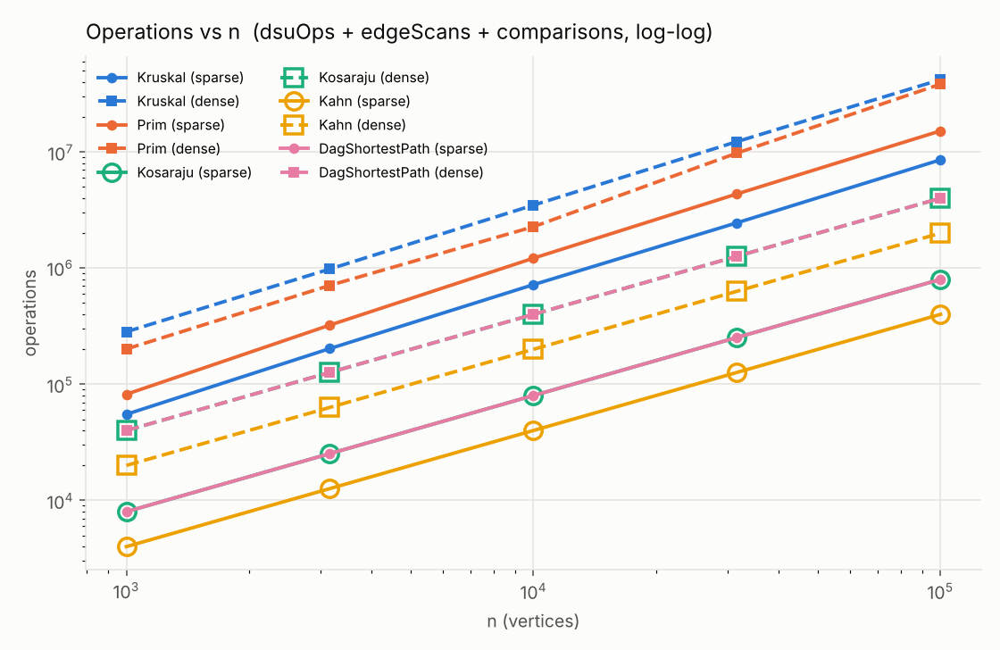
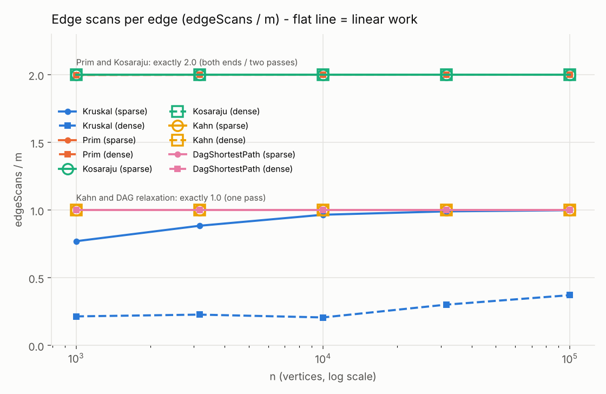
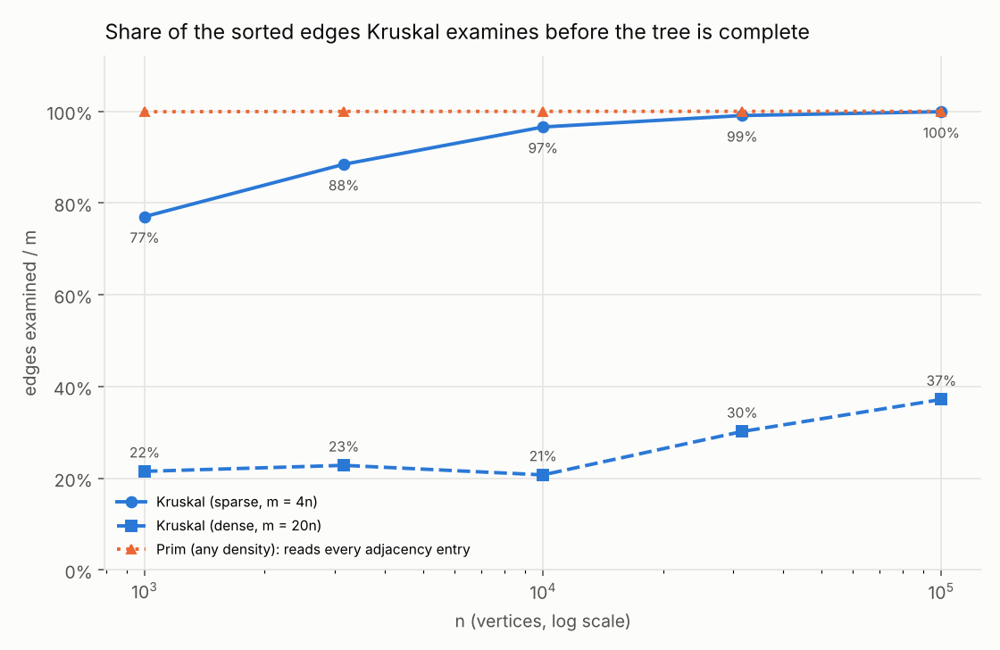

# Assignment 3 Report — City Network & Job Scheduler

**Yersaiyn Taubay, SE-2524** · Design and Analysis of Algorithms

All numbers below come from one command (`mvn -q compile exec:exec`, generator seed 42) and are in
`results/results.csv`. The tables were produced by `scripts/analyze.py` from that file. The benchmark
checks itself: it stops with an exception if Kruskal and Prim disagree, if a topological order is
invalid, if Tarjan and Kosaraju disagree, or if any of the 30 reference values or the scan identities
(Kosaraju = 2m, Kahn = m, DAG relaxation = m) differ. All ten graphs pass.

| Graph (n / m) | MST weight | SCC count | Sum of DAG distances |
|---|---:|---:|---:|
| 1 000 / 4 000 | 147 970 | 27 | 396 274 |
| 1 000 / 20 000 | 30 363 | 1 | 252 411 |
| 3 162 / 12 648 | 468 911 | 137 | 1 271 911 |
| 3 162 / 63 240 | 97 589 | 1 | 723 157 |
| 10 000 / 40 000 | 1 486 139 | 373 | 3 941 828 |
| 10 000 / 200 000 | 309 550 | 1 | 2 381 342 |
| 31 623 / 126 492 | 4 715 515 | 1 188 | 12 551 891 |
| 31 623 / 632 460 | 968 517 | 1 | 7 376 612 |
| 100 000 / 400 000 | 15 012 094 | 3 923 | 40 096 539 |
| 100 000 / 2 000 000 | 3 056 681 | 1 | 23 512 087 |

*Every value equals the reference table.* One detail of the generator matters for this: when the random
pair has `b == a`, only `b` is redrawn (`do b = rnd.nextInt(n) while (b == a)`). Redrawing both ends
reproduces only the first row, because 1 000 / 4 000 happens to draw no self-loop.

## 1. Complexity table

| Algorithm | Time | Extra space | Justification |
|---|---|---|---|
| DSU `find` / `union` | O(α(n)) amortized | O(n) | Union by rank keeps trees O(log n) deep; path compression flattens every path it walks. Together (Tarjan's analysis) the amortized cost is the inverse Ackermann function, α(n) ≤ 4 for any realistic n. |
| Kruskal | O(E log E) | O(E + V) | Merge sort of E edges dominates; then at most E iterations of 2 finds and V − 1 successful unions, each O(α(V)). Sorted copy of the edges + DSU arrays. |
| Prim (lazy, binary heap) | O(E log E) = O(E log V) | O(E + V) | Every adjacency entry (2E) is scanned once; each scan may push one heap entry, push/poll cost O(log E), and log E ≤ 2 log V. The heap can hold O(E) stale entries. |
| Kosaraju | O(V + E) | O(V + E) | Two DFS passes, each visiting every vertex once and every edge once (2E scans in total), plus O(E) to build the reverse graph, which is the extra E of space. |
| Kahn | O(V + E) | O(V) | In-degrees in one pass over E; each vertex enters and leaves the queue once; each edge is examined once when its tail leaves the queue. |
| DAG shortest paths | O(V + E) | O(V) | One topological order (O(V + E)) and one relaxation per edge; `dist[]` and `parent[]` are O(V). |
| *Tarjan (bonus)* | O(V + E) | O(V) | One DFS, each edge scanned once; index/lowlink/active stack are O(V); no reverse graph. |

## 2. Counters vs formulas

The counters are incremented inside the algorithms (`Metrics` fields), never computed from formulas.
A ratio *counter / formula* that stays constant as n grows by a factor of 100 confirms the complexity class.

**Sparse graphs (m = 4n)**

| Algorithm | Ratio | n = 1 000 | 3 162 | 10 000 | 31 623 | 100 000 |
|---|---|---:|---:|---:|---:|---:|
| Kruskal | comparisons / (E log₂ E) | 0.896 | 0.928 | 0.940 | 0.926 | 0.949 |
| Kruskal | dsuOps / edgeScans | 2.972 | 2.848 | 2.776 | 2.757 | 2.751 |
| Prim | edgeScans / E | 1.999 | 2.000 | 2.000 | 2.000 | 2.000 |
| Prim | comparisons / (E log₂ V) | 1.857 | 2.027 | 2.140 | 2.169 | 2.167 |
| Kosaraju | edgeScans / (V + E) | 1.600 | 1.600 | 1.600 | 1.600 | 1.600 |
| Kahn | edgeScans / (V + E) | 0.800 | 0.800 | 0.800 | 0.800 | 0.800 |
| DagShortestPath | edgeScans / (V + E) | 0.800 | 0.800 | 0.800 | 0.800 | 0.800 |

**Dense graphs (m = 20n)**

| Algorithm | Ratio | n = 1 000 | 3 162 | 10 000 | 31 623 | 100 000 |
|---|---|---:|---:|---:|---:|---:|
| Kruskal | comparisons / (E log₂ E) | 0.935 | 0.922 | 0.946 | 0.953 | 0.942 |
| Kruskal | dsuOps / edgeScans | 2.697 | 2.657 | 2.723 | 2.497 | 2.403 |
| Prim | edgeScans / E | 1.998 | 1.999 | 2.000 | 2.000 | 2.000 |
| Prim | comparisons / (E log₂ V) | 0.809 | 0.794 | 0.705 | 0.902 | 1.034 |
| Kosaraju | edgeScans / (V + E) | 1.905 | 1.905 | 1.905 | 1.905 | 1.905 |
| Kahn | edgeScans / (V + E) | 0.952 | 0.952 | 0.952 | 0.952 | 0.952 |
| DagShortestPath | edgeScans / (V + E) | 0.952 | 0.952 | 0.952 | 0.952 | 0.952 |

How to read the table:

- **Traversals are exact.** Kosaraju scans exactly 2m edges, Kahn and the DAG relaxation exactly m, at every
  size and density, so edgeScans / (V + E) is 2m/(n + m) = 1.600 (sparse) and 1.905 (dense) — identical to
  three decimals across a 100× range of n. Prim scans 2m adjacency entries (both ends of each undirected edge).
- **Kruskal's sort is E log E.** Bottom-up merge sort makes about E log₂ E − 1.25 E comparisons, so the ratio
  settles at ≈ 0.93–0.95 for both densities.
- **Kruskal's DSU work is constant per examined edge.** The code does `find(u)`, `find(v)` for every examined edge
  and `union(u, v)` (2 more finds + 1 union) for each of the n − 1 accepted ones, so exactly
  dsuOps = 2·edgeScans + 3(n − 1); the benchmark output satisfies this for all ten graphs. Per examined edge that
  is between 2 and 3 operations — the α(n) factor is invisible because each find is O(1) after compression.
  The suggested ratio dsuOps / E is not constant on dense graphs (0.58 → 0.89) for a different reason:
  Kruskal stops early, and the share of edges it examines changes with n (see plot 3).
- **Prim's heap work is bounded by E log V.** comparisons / (E log₂ V) stays below 2.2. It is lower on dense
  graphs because most of the heap entries are pushed when the heap is still small, and stale entries are skipped.

## 3. Correctness arguments

**Cut property (Kruskal and Prim).** Let S be any set of vertices and let e be a lightest edge crossing the cut
(S, V \ S). Take any MST T. If e ∉ T, adding e to T creates exactly one cycle, and that cycle must cross the cut
a second time through some edge f ∈ T. Since e is a lightest crossing edge, w(e) ≤ w(f), so T − f + e is again
a spanning tree of weight ≤ w(T), i.e. also an MST — and it contains e. Hence a lightest crossing edge is always
*safe*: some MST contains it together with all edges chosen so far (if they respect the cut). Prim applies this
to the cut (tree, rest): the heap returns the lightest edge leaving the current tree. Kruskal applies it to the
cut (component of u, everything else): when the next sorted edge has find(u) ≠ find(v), every lighter edge was
already processed and either joined components or was inside one, so no lighter edge crosses that cut. With equal
weights the trees may differ, but every MST has the same total weight — which is exactly what the benchmark checks.

**Induction on the topological order (DAG shortest paths).** Process vertices in a topological order
v₁, v₂, …, vₙ. Claim: when vᵢ is processed, dist[vᵢ] is already the true shortest distance δ(vᵢ). Base: a vertex
of in-degree 0 has no incoming edges, so its only path from the super-source is the zero-length one, and
dist = 0 is correct. Step: every edge (u, vᵢ) has u earlier in the order, so u was processed before vᵢ with its
correct δ(u) (induction hypothesis) and relaxed (u, vᵢ). A shortest path to vᵢ ends with some edge (u, vᵢ), so
dist[vᵢ] ≤ δ(u) + w(u, vᵢ) = δ(vᵢ); relaxation never sets a value below a real path length, so equality holds.
Nothing processed later can point back to vᵢ, so dist[vᵢ] never changes again and one pass is enough. The
argument never used w ≥ 0, so **negative weights are safe**. In a general graph an edge may point back to an
already-finished vertex, so a single pass is not enough (Bellman–Ford needs V − 1 rounds), Dijkstra's "finalize the
closest vertex" step fails with negative edges, and a negative cycle makes the shortest distance undefined (−∞).
A DAG has no cycles at all, so none of these problems can occur.

**Why α(n) for DSU.** Union by rank alone gives height ≤ log₂ n; path compression alone gives O(log n) amortized.
With both, Tarjan's potential argument bounds m operations by O(m · α(n)), where α grows so slowly that
α(n) ≤ 4 for every n below 2^65536. In practice each operation is a constant; the measured 2–3 dsuOps per examined
edge in Kruskal confirms that the structure adds no hidden log factor.

## 4. Which algorithm when

| Situation | Choice | Why |
|---|---|---|
| MST, **sparse** graph, or edges given as a list (file, database rows) | **Kruskal** | Works directly on the edge list, no adjacency list needed. At n = 100 000, m = 4n it did 8.6 M operations vs Prim's 15.2 M: sorting 4n edges once is cheaper than 8n heap pushes/polls. |
| MST, **dense** graph (m ≫ n), adjacency list available | **Prim** (lazy heap here; indexed heap or O(V²) array Prim for a near-complete graph) | Kruskal examined only 21–37 % of the edges, but it still sorts all of them: at n = 100 000, m = 20n it did 41.9 M operations vs Prim's 38.4 M. For E ≈ V² array Prim is O(V²) with no log factor at all. |
| MST, graph already stored as an **adjacency list**, or need a tree grown from one district | **Prim** | Uses the adjacency list as is and grows one tree from a chosen root; memory is the heap, not a sorted copy of E. |
| MST of a **disconnected** network | Either (both return a forest) | Both report the number of components; Kruskal needs no restarts. |
| Is there a **deadlock / cycle**, and which jobs form it? | **Tarjan** (or Kosaraju) | SCCs of size > 1 (or with a self-loop) are exactly the deadlocked groups. Tarjan does it in one pass (m scans, no reverse graph); Kosaraju is simpler to explain and verify. Both iterative for 100 000+ vertices. |
| Only need a **run order**, cycle possible | **Kahn** | O(V + E), no recursion, and it detects a cycle for free (fewer than n vertices leave the queue). Gives a natural "ready queue" for a scheduler. |
| **Shortest / fastest route through a pipeline** (DAG), negative weights possible | **Topological order + one relaxation pass** | O(V + E), exactly m relaxations, handles negative weights; Dijkstra would be slower (log factor) and wrong with negative weights. |
| **Critical path** (longest chain of dependent jobs) | Same pass with the sign flipped | Longest path is easy only in a DAG; in a general graph first condense SCCs (bonus B). |
| General graph, negative weights, cycles possible | Bellman–Ford (not in this project) | The DAG pass is only valid when there is no cycle; check with Kahn first. |

## 5. Slope check (log-log fit over the five sizes)

| Algorithm | Counter | Slope sparse | Slope dense |
|---|---|---:|---:|
| Kosaraju | edgeScans | **1.000** | **1.000** |
| Kahn | edgeScans | **1.000** | **1.000** |
| DagShortestPath | edgeScans | **1.000** | **1.000** |
| Prim | edgeScans | 1.000 | 1.000 |
| Kruskal | total work (comparisons + dsuOps + scans) | **1.093** | **1.088** |
| Prim | total work (heap comparisons + scans) | 1.133 | 1.140 |
| Kruskal | edgeScans | 1.055 | 1.119 |

The traversals give exactly 1.00: linear work. Kruskal's total work is steeper, **1.09**, because of the log factor in
E log E (on sparse graphs log₂ E grows from 12.0 to 18.6 while n grows ×100, a factor 1.55 ≈ 100^0.095). Prim's heap
work shows the same log factor. Kruskal's *edgeScans* slope is also above 1 on dense graphs: to connect n random
vertices you need on the order of n log n random edges, so the examined share grows from 21 % to 37 %.

## 6. Plots

*Plot 1.* All lines are parallel straight lines on log-log axes; Kruskal and Prim lie higher and bend slightly
upward (the log factor). Kosaraju (2m scans) coincides with the DAG pass (m scans + m comparisons).

*Plot 2.* Flat lines at exactly 2.0 (Prim, Kosaraju) and 1.0 (Kahn, DAG relaxation) confirm linear work.
Kruskal is the only algorithm below 1: it stops when the tree is complete.

*Plot 3.* On sparse graphs (m = 4n) Kruskal must look at almost every edge (77 % → 100 %), because with only
4 edges per vertex the last vertices are connected only by the heaviest edges. On dense graphs (m = 20n) the tree is
complete after 21–37 % of the sorted edges. Prim always reads every adjacency entry (100 %). This explains where each
algorithm wins. Kruskal's scan loop gets cheaper with density, but its sort always pays for all E edges, so its total
work grows like E log E regardless; Prim's heap work grows like E log V. On sparse graphs Kruskal is cheaper (8.6 M vs
15.2 M operations at n = 100 000); on dense graphs the sort of 2 million edges dominates and Prim edges ahead
(38.4 M vs 41.9 M). Early stopping helps Kruskal on dense graphs only in the DSU phase, not in the sort.

## 7. A paragraph on time

Median of 5 runs, OpenJDK 21, cloud Linux VM: on the largest graphs Kahn took 18 / 42 ms (sparse / dense), the DAG
relaxation 28 / 37 ms, Kosaraju 122 / 592 ms, Kruskal 107 / 919 ms and Prim 257 / 1 020 ms. The two smallest graphs run
in under 3 ms and are mostly noise (JIT compilation, garbage collection, timer resolution). The order roughly agrees
with the counters, but the clock also measures things that are not the algorithm: Kosaraju allocates a whole reverse
graph (it was 4–6× slower than Tarjan although it scans only 2× more edges), Prim allocates one heap entry object per
push, and cache misses dominate random adjacency access at 2 million edges. The same code on another laptop, another
JVM or with a browser open would give different milliseconds, while every counter in `results.csv` is identical on any
machine (the benchmark even verifies that all 5 runs produce the same counters). That is why conclusions in this report
are drawn from counters, and time is reported only as supporting context.

## 8. Bonus

**A — Tarjan's SCC.** `daa.scc.Tarjan` finds the components in one iterative DFS with `index[]`, `lowlink[]` and a
stack of active vertices. On all ten generated graphs and in the tests it returns the same partition as Kosaraju
(compared via a canonical labelling). It scans **m** edges versus Kosaraju's **2m** (e.g. 2 000 000 vs 4 000 000 at
n = 100 000 dense), and it never builds the reverse graph. The saving comes from computing `lowlink` during the first
DFS: Tarjan recognizes the root of a component when it finishes it (`lowlink == index`), so the second pass over the
transposed graph is unnecessary (`results/bonus_tarjan.csv`).

**B — Condensation and critical path.** `daa.scc.Condensation` maps each SCC to one vertex and keeps the edges between
different components; the result is always a DAG (a cycle between components would merge them into one SCC; the tests
check acyclicity with Kahn on random graphs). The longest path is then one relaxation pass in topological order with the
sign flipped (minimize −w). This is easy in a DAG because the same induction as in §3 applies; in a general graph a
longest *simple* path is NP-hard (it would solve Hamiltonian path), and with a positive cycle a non-simple "longest path"
is unbounded. In scheduling, the critical path is the longest chain of dependent jobs: its length is the minimum time
for the whole pipeline even with unlimited workers, and any delay of a job on it delays everything (CPM/PERT). For the
generated sparse directed graphs the condensations have 27 – 3 923 vertices and critical paths of length 2 992 – 4 977;
dense ones condense to a single vertex. For the DAGs, the critical path is 10 134 – 59 816
(`results/bonus_critical_path.csv`).

## 9. Implementation notes for the defense

- **One `Graph` class** (adjacency list of `Edge` objects + edge list) serves both directed and undirected graphs;
  all six algorithms (and both bonuses) take a `Graph`, so the benchmark is one loop.
- **No recursion anywhere** in the traversals: Kosaraju and Tarjan use an `int[]` stack plus a per-vertex position
  in the adjacency list. `SccTest.stackSafety` runs both on a 100 000-vertex path inside a thread with a **256 KB**
  stack (a recursive DFS needs ~100 000 frames and would overflow), and checks `maxDepth == 100 000`.
- **Edge cases:** self-loops, parallel edges, isolated vertices, empty and single-vertex graphs are covered by tests;
  MST on a disconnected graph returns a forest plus the component count; Kahn on a cyclic graph returns `hasCycle = true`
  instead of an order; the DAG pass refuses a cyclic graph.
- **Counters:** `dsuOps` (find + successful union, inside `DSU`), `edgeScans`, `comparisons` (merge sort, heap comparator,
  relaxations) and `maxDepth` (explicit stack; for Prim and Kahn the largest heap/queue size).
